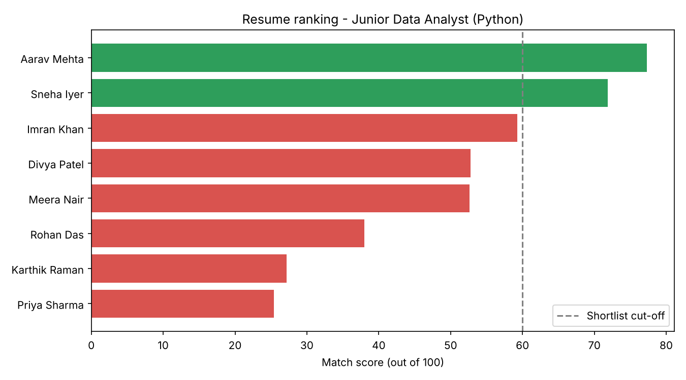

# Automated Resume Screening Tool

A Python tool that reads resumes (PDF / DOCX / TXT), compares them with a job description, ranks candidates, flags missing must-have skills and exports shortlist / reject reports. It also includes a SQLite database, a FastAPI service, an evaluation script and tests.

> All sample resumes are **synthetic (made-up)**. They are created by `generate_samples.py`.

## Problem Statement
HR teams receive hundreds of resumes per job. Reading them manually is slow and inconsistent. This tool screens resumes the way ATS systems do: skills, keywords, experience and job-description similarity.

## Workflow
`Resume upload -> text extraction -> cleaning -> skill extraction -> job matching -> score -> shortlist/reject -> report`

## Features
- Text extraction from PDF, DOCX and TXT
- Text cleaning and skill extraction (skill dictionary with aliases)
- TF-IDF + cosine similarity (optional sentence-transformer embeddings)
- Score out of 100: similarity 40%, must-have skills 35%, nice-to-have 10%, experience 15%
- Must-have gap flags, experience check, keyword-stuffing flag
- CSV, text report and ranking chart
- SQLite database, FastAPI API, audit log, PII redaction, candidate deletion
- Evaluation (ROC-AUC, PR-AUC, Top-k precision) and tests

## Files
| File | Purpose |
|---|---|
| main.py | runs the full screening and saves reports |
| generate_samples.py | creates 8 synthetic resumes in a `resumes/` folder |
| config.py | paths, weights, decision rules |
| extractor.py, cleaner.py, skills.py | text extraction, cleaning, skill extraction |
| features.py, scorer.py | similarity, score, decision |
| report.py | CSV, text report, chart |
| schema.sql, database.py, service.py, rank.py, redact.py | database, ranking and privacy |
| api.py | FastAPI service |
| app.py | optional Streamlit dashboard |
| evaluate.py, labeled_pairs.csv | ranking quality check |
| test_core.py | tests |
| job_description.txt, job_config.json | the job to screen for |
| ranking_report.csv, shortlisted_candidates.csv, rejected_candidates.csv, screening_summary.txt, ranking_chart.png, evaluation.txt | sample outputs |
| PROJECT_GUIDE.md | full project guide and interview preparation |

## How to Run
```bash
pip install -r requirements.txt
python generate_samples.py     # creates the sample resumes
python main.py                 # runs the screening
python demo_db.py              # database pipeline
python evaluate.py             # ranking quality
python test_core.py            # tests
uvicorn api:app --reload       # API docs at http://localhost:8000/docs
streamlit run app.py           # optional dashboard
```

## Sample Output
| Rank | Candidate | Score | Must-have | Years | Decision |
|---|---|---|---|---|---|
| 1 | Aarav Mehta | 77.3 | 4/4 | 3.0 | SHORTLIST |
| 2 | Sneha Iyer | 71.9 | 4/4 | 4.0 | SHORTLIST |
| 3 | Imran Khan | 59.3 | 4/4 | 0.0 | REJECT (keyword stuffing, no experience) |
| 4 | Divya Patel | 52.8 | 2/4 | 5.0 | REJECT (missing python, pandas) |
| 5 | Meera Nair | 52.6 | 4/4 | 0.5 | REJECT (experience below 2 yrs) |

Evaluation on the labelled toy set: ROC-AUC 0.867, PR-AUC 0.867, shortlist precision 1.0.

## Screenshot


## Ethics
Never uses gender, age, religion or caste. Emails and phone numbers are redacted before storage. A human recruiter makes the final decision.

## Future Improvements
Next.js recruiter dashboard, Docker deployment, semantic embeddings, education extraction.
